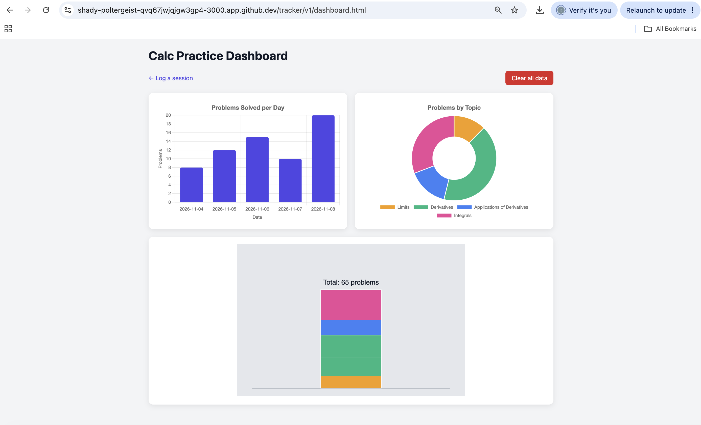
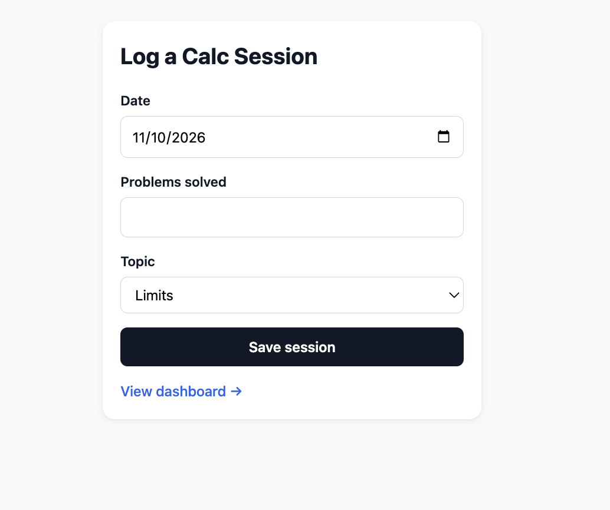
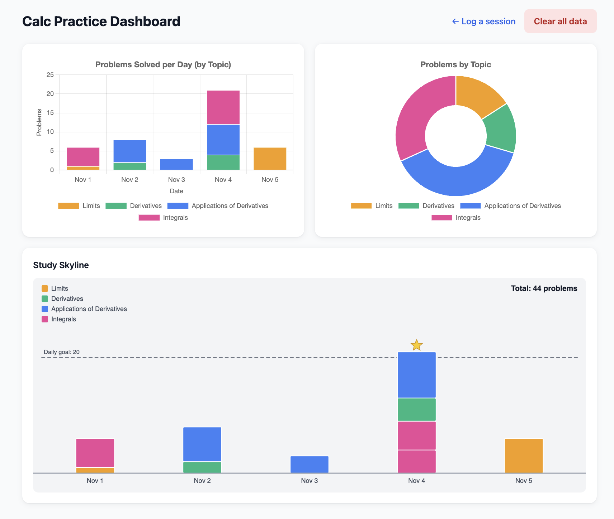
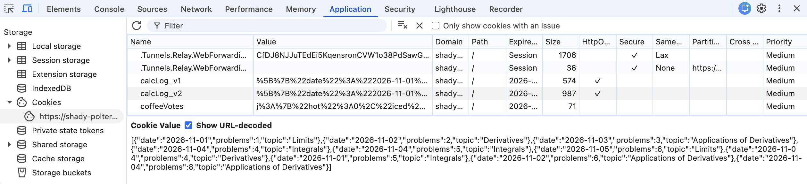

# Cookie Tracker – Calc Practice Sessions

🎥 **Video walkthrough:** (https://drive.google.com/file/d/1S5jEx99ESchbODBEFp9DytI8GBMl_NaL/view?usp=sharing)

## What I tracked and why

I tracked my calculus practice sessions: how many problems I solved in each session and which topic they were on (Limits, Derivatives, Applications of Derivatives, or Integrals). I'm preparing for my Calculus I final, so this is something I actually do every day, and I wanted to see two things at a glance: whether I'm putting in consistent daily effort, and whether I'm neglecting any topic.

Each entry has one number (problems solved) and one category (topic), plus a date. All entries are stored in a single cookie through Express and cookie-parser.

**Why a "study skyline" for the p5 sketch:** studying for a final is something you build day by day, so I represented each day as a tower and each session as a block stacked on top. Taller towers mean bigger study days, the block colors show which topics I covered, and a dashed goal line at 20 problems with a star for days that pass it turns the dashboard into motivation, not just a report. The same four topic colors are used in both charts and the sketch so everything reads as one system.

## Version 1 (prompt v1)

[Prompt v1](tracker-docs/prompt-v1.md)



**What worked / what didn't:**

What worked: v1 ran on the first try. Saving to the cookie, the data route, both charts, refreshing without losing data, and the clear button all worked. The form defaulted to today's date and the layout stacked correctly on a narrow window.

What didn't:
- The bar chart was a single indigo color, so it wasted the topic data. When two sessions on the same day were combined into one bar, there was no way to tell which topics made it up.
- The p5 sketch was one plain column in a mostly empty gray box, with no labels, no legend, and no dates. With small totals (5 problems) the tower was just a thin sliver.
- After "Clear all data" the sketch disappeared completely instead of showing an empty state.
- Validation was too loose: a session with 0 problems and one with 999 problems were both saved.
- The browser's default "Please fill out this field" popup was the only feedback for bad input.
- Dates showed as 2026-11-04 instead of something readable.

The full test log is at the top of [prompt v2](tracker-docs/prompt-v2.md).

## Version 2 – Final (prompt v2)

[Prompt v2](tracker-docs/prompt-v2.md)







**Biggest change from v1 to v2, and why it helped:**

The biggest change was making the topic data visible everywhere. In v2, the bar chart is stacked by topic, the doughnut uses the same colors, and the sketch became a full skyline: one tower per day, one colored block per session, a legend, readable dates, a daily goal line, a star on days that reach the goal, and a short drop-in animation when a new session is added. In v1 you could only see how much I studied. In v2 you can see how much, on which days, on which topics, and whether I hit my goal, all from the same data.

The other big improvement was validation. v2 only accepts whole numbers from 1 to 100, checks the date and topic on the server, and shows my own clear error messages under the field instead of the browser's default popups.

Writing v2 also taught me to be specific in prompts. "Make a chart" in v1 gave me something generic. Spelling out the chart type, axes, colors, tooltips, empty states and scaling in v2 got me almost exactly what I pictured.

**Hand edits I made (if any):**

None. All v1 and v2 code is exactly what the AI generated from my prompts.

## How my code works (in my own words)

### Saving the cookie

```js
app.post("/tracker/v2/save", (req, res) => {
    const body = req.body || {};
    const problems = parseProblemsV2(body.problems);
    const topic = body.topic;
    const date = body.date;

    if (!Number.isInteger(problems) || problems < 1 || problems > 100) {
        return res.status(400).json({
            success: false,
            error: "Problems must be a whole number from 1 to 100."
        });
    }
    if (!TRACKER_TOPICS.includes(topic)) {
        return res.status(400).json({
            success: false,
            error: "Topic must be one of: " + TRACKER_TOPICS.join(", ") + "."
        });
    }
    if (!isValidTrackerDateV2(date)) {
        return res.status(400).json({
            success: false,
            error: "Date must be a real date in YYYY-MM-DD format."
        });
    }

    let log = readTrackerLogV2(req);
    log.push({ date: date, problems: problems, topic: topic });
    log = log.slice(-30); // keep the last 30 entries so the cookie stays under 4 KB

    res.cookie("calcLog_v2", JSON.stringify(log), TRACKER_COOKIE_OPTIONS);
    res.json({ success: true, count: log.length });
});
```

1. The program rejects the entry because the number of problems is outside the allowed range. It shows an error instead of saving it.
2. It gets the old entries from the cookie and adds the new entry to the end of the list.
3. Cookies have limited storage space so it only keeps the 30 newest entries. It turns the updated list into text and saves it back into the cookie.

### Getting the data to the dashboard

```js
app.get("/tracker/v2/data", (req, res) => {
    res.json(readTrackerLogV2(req));
});
```

```js
async function fetchEntries() {
    try {
        const response = await fetch("/tracker/v2/data");
        if (!response.ok) {
            return [];
        }
        const data = await response.json();
        return Array.isArray(data) ? data : [];
    } catch (err) {
        return [];
    }
}

async function initDashboard() {
    document.getElementById("clearBtn").addEventListener("click", handleClear);
    const entries = await fetchEntries();
    renderDashboard(entries);
}
```
1. It sends the saved tracker entries back to the dashboard so they can be displayed.
2. It uses fetch to ask the server for the saved entries. Once it gets them, it uses that information to display the dashboard.

### Chart 1

```js
function buildBarData(entries) {
    const dates = Array.from(new Set(entries.map(function (e) { return e.date; }))).sort();
    const datasets = TOPIC_ORDER.map(function (topic) {
        const values = dates.map(function (date) {
            return entries
                .filter(function (e) { return e.date === date && e.topic === topic; })
                .reduce(function (sum, e) { return sum + e.problems; }, 0);
        });
        return {
            label: topic,
            data: values,
            backgroundColor: TOPIC_COLORS[topic],
            borderColor: "#FFFFFF",
            borderWidth: 1
        };
    });
    return { labels: dates.map(formatShortDate), datasets: datasets };
}
```

1. It looks at the dates in the saved entries and uses them to create the dates shown along the bottom of the chart.
2. It adds up the number of problems completed for each topic on that day. The more problems completed, the taller that topic's section is.

### p5 sketch

1. One tower represents a day of studying. Each block represents one session I logged that day.
2. The height depends on how many problems I did that session. The color helps show which topic the block represents.

## Something the AI got wrong

When generating v2, the AI first linked Chart.js from the CDN using `chart.umd.min.js`, a file that doesn't exist in Chart.js 4.4.1. That would have made both charts fail to load with console errors. It also drew the p5 text in a serif (Times) font because p5 doesn't accept a CSS font list, and on a phone-width screen the p5 canvas forced the page to scroll sideways. It caught and fixed all three while testing, but it shows the code can look right and still break, so testing in the browser matters.

In v1, the AI's validation only rejected negative numbers, so a 0-problem session and a 999-problem session both saved. My v1 prompt didn't give a range, so I fixed that by specifying 1–100 in v2.